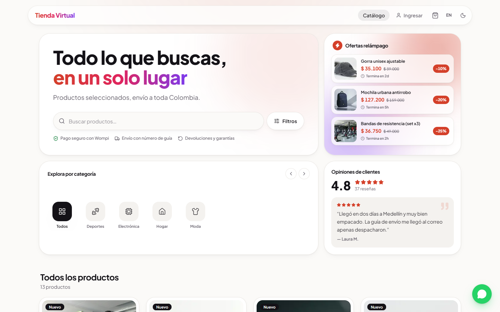
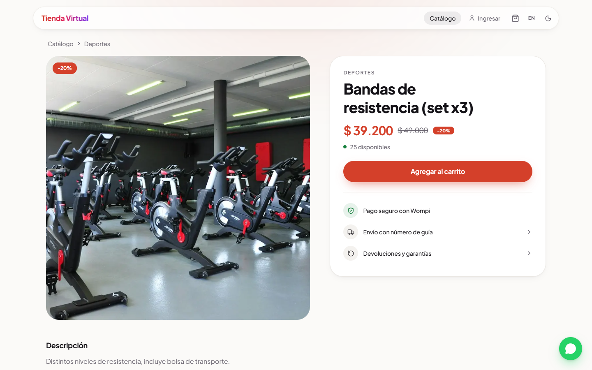
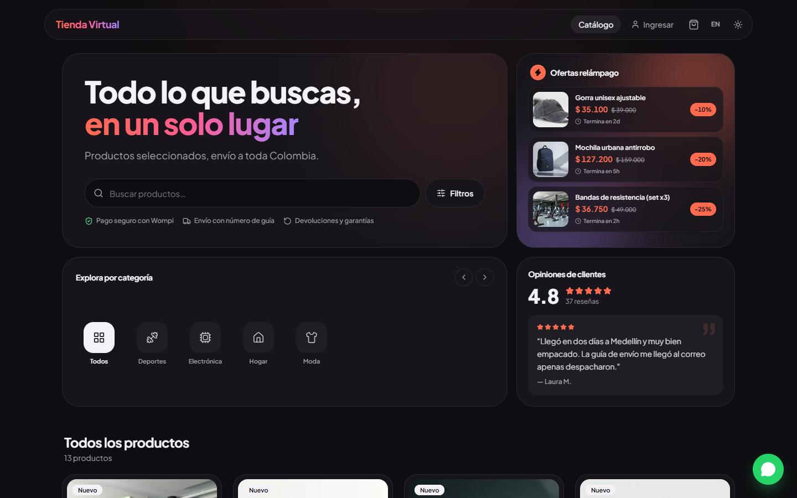
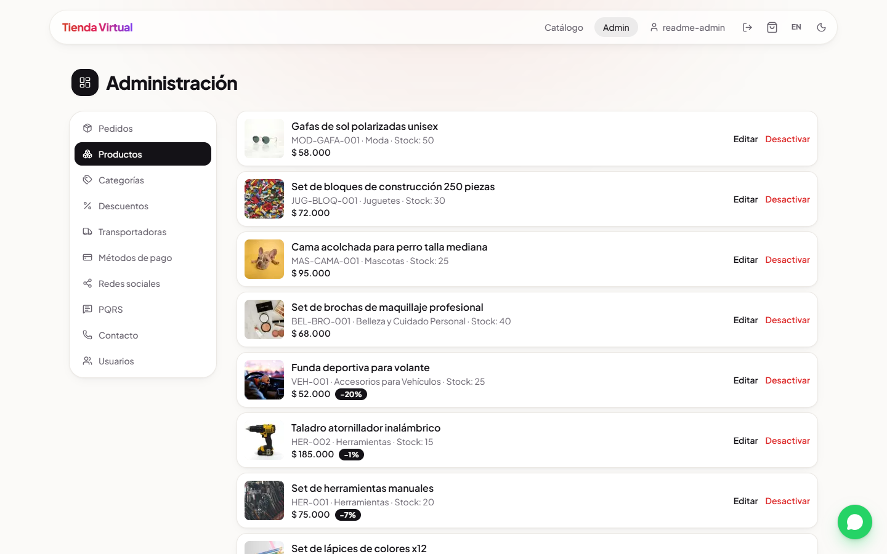
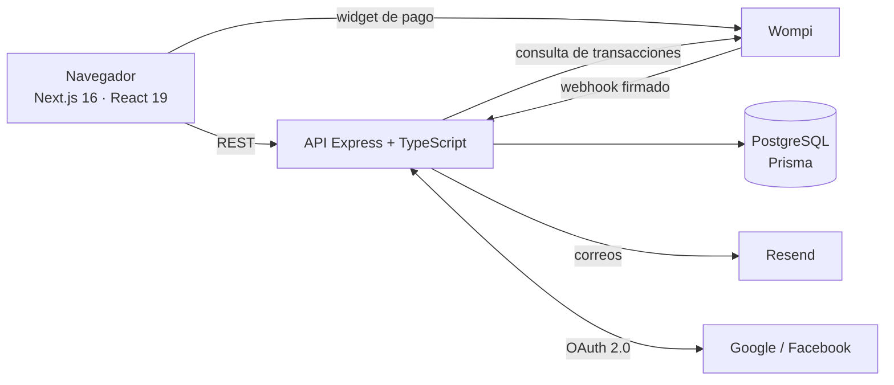

# Tienda Virtual — e-commerce colombiano

[](https://github.com/mulettcastillo2018/tienda-virtual/actions/workflows/ci.yml)

Tienda en línea completa para un comercio colombiano: catálogo, carrito, pagos con Wompi, descuentos con trazabilidad, posventa según la Ley 1480 (PQRS con área jurídica), panel de administración, bilingüe (ES/EN) y con modo oscuro.

**Demo en línea:** [tienda-mulett.vercel.app](https://tienda-mulett.vercel.app). Los pagos usan el ambiente de pruebas de Wompi: compra con la tarjeta `4242 4242 4242 4242` (cualquier fecha futura y CVC) o con el Nequi `3991111111`. La API está en un plan gratuito que se duerme: la primera visita puede tardar cerca de un minuto.

> **Construido dirigiendo un agente de IA** (Claude Code). Yo definí el producto y las reglas del negocio, pedí un análisis técnico completo y decidí el orden de las correcciones; el agente escribió el código y las pruebas. Detalle en [Cómo se construyó con IA](#cómo-se-construyó-con-ia).



<table>
  <tr>
    <td align="center"><br><sub>Detalle de producto con descuento vigente</sub></td>
    <td align="center"><br><sub>Modo oscuro</sub></td>
  </tr>
  <tr>
    <td align="center" colspan="2"><br><sub>Panel de administración</sub></td>
  </tr>
</table>

## Qué hace

**Para el cliente**
- Catálogo con búsqueda, filtros por precio y marca, categorías con íconos y galería de 4 imágenes por producto.
- Compra sin crear cuenta: el carrito vive en el navegador, se paga con correo y dirección, y el pedido se sigue con un enlace firmado que llega al correo. Al iniciar sesión, el carrito pasa a la cuenta.
- Checkout por pasos con el costo de envío antes de confirmar, y dos formas de pago: en línea con Wompi (tarjeta, PSE, Nequi) o contra entrega en las ciudades configuradas.
- Plazo para pagar: si un pago se rechaza puede reintentar con otro medio; si no paga a tiempo, el pedido se cancela solo y los productos vuelven a su carrito.
- Seguimiento del pedido paso a paso (pagado, en preparación, enviado, entregado) con la fecha de cada paso.
- El carrito avisa si un producto se agotó, quedan menos unidades o se retiró de la tienda, y no deja pagar hasta ajustarlo.
- Ofertas relámpago, reseñas de la tienda (solo de compradores reales), inicio de sesión con Google o Facebook, recuperación de contraseña.
- PQRS (peticiones, quejas, reclamos y sugerencias) con plazo legal de 15 días hábiles, línea de tiempo y adjuntos privados.
- Español e inglés, modo claro y oscuro.

**Para la tienda**
- Productos, categorías, marcas, transportadoras, medios de pago, redes sociales e información de contacto administrables.
- Descuentos con duración: cada venta queda enlazada a la campaña de descuento que tenía, para poder explicar cualquier precio pasado.
- Pedidos por estado, con búsqueda y paginación: preparación, despacho con guía, entrega, bitácora de quién hizo cada cambio y marca de revisión para pagos que requieren reembolso.
- La dirección de envío se copia al pedido: si el cliente la cambia después, el despacho va a donde se pidió.
- Pago contra entrega con reglas editables (ciudades, valor máximo y recargo): cada pedido se confirma con el cliente (con un mensaje de WhatsApp ya armado), el cobro queda registrado al entregarlo y, si no se concreta, el inventario vuelve.
- Tablero de ventas de 7, 30 o 90 días: ventas, pedidos, ticket promedio y unidades comparados con el periodo anterior, ventas por día, lo más vendido y lo que falta despachar.
- Área jurídica que responde las PQRS; el administrador solo lo hace si no hay nadie del área.

## Seguridad y calidad

Después de construir la tienda, se hizo un [análisis técnico y de negocio](docs/analisis-2026-09-28.pdf) con una hoja de ruta por fases. Ya están hechas las fases 0 a 5:

| Fase | Qué se corrigió |
|---|---|
| 0 · Versionar | Todo el trabajo quedó en Git y en este repositorio. |
| 1 · Pagos | Webhook de Wompi idempotente y con validación de monto; un rechazo ya no cancela el pedido; vencimiento automático que libera el inventario; sincronización directa con la API de Wompi. |
| 2 · Cuentas | Sesiones revocables al instante (desactivar, cambiar rol o contraseña), límites de intentos, OAuth con `state` y sin vinculación automática de cuentas, correos escapados, cabeceras de seguridad. |
| 3 · Archivos | Tipo real de cada archivo por su contenido, adjuntos de PQRS privados con enlaces firmados, imágenes sin dominio fijo, integración continua. |
| 4 · Operación | Estados de pedido completos (en preparación, entregado) con bitácora; carrito que valida producto activo, inventario y tope de 99 unidades; copia de la dirección en el pedido; índices en las llaves foráneas y paginación de pedidos, usuarios y PQRS; tablero de ventas. |
| 5 · Crecimiento | Inicio y fichas renderizados en el servidor con metadatos, datos estructurados de producto, `sitemap.xml`, `robots.txt` e imagen para compartir; compra como invitado; pago contra entrega. |

Las pruebas automáticas (209 comprobaciones) corren en cada cambio en GitHub Actions contra una base de datos nueva.

## Arquitectura



| Capa | Tecnologías |
|---|---|
| Frontend | Next.js 16 (App Router), React 19, TypeScript, Tailwind CSS v4, Zustand, i18n propio (ES/EN) |
| Backend | Node.js, Express, TypeScript, zod, Multer |
| Datos | PostgreSQL (Neon), Prisma ORM, 19 migraciones |
| Pagos y correo | Wompi (firma de integridad, webhooks, API), Resend |
| Seguridad | JWT con versión de sesión, bcrypt, OAuth 2.0, HMAC para enlaces firmados, límites de intentos |
| Calidad | Pruebas de extremo a extremo propias, GitHub Actions con PostgreSQL de servicio |

## Cómo se construyó con IA

**Reparto del trabajo**

| Yo (producto y dirección) | El agente de IA (Claude Code) |
|---|---|
| Definí la tienda y las reglas del negocio colombiano | Propuso la arquitectura y escribió el código |
| Pedí el análisis y decidí el orden de las correcciones | Hizo el análisis y ejecutó cada fase con sus pruebas |
| Contrasté con otra IA: una revisión externa encontró una condición de carrera en el inventario, que luego se corrigió y se probó con compras simultáneas | Escribió migraciones de datos y la integración continua |
| Exigí verificación y datos de prueba limpios | Resolvió los bloqueos del entorno corporativo |

**Decisiones de producto**
- Las PQRS las responde un **área jurídica**, no el administrador, con el plazo de la Ley 1480.
- **Trazabilidad de descuentos**: poder responder "por qué este producto se vendió más barato esa semana".
- Exactamente **4 imágenes por producto** (principal y 3 miniaturas) para un catálogo uniforme.
- Solo quien compró de verdad puede dejar una reseña, una por pedido.

**Cronología**: construcción del 24 al 26 de septiembre de 2026; el 28, análisis y fases 0 a 3 (ver el historial de commits).

## Correr en local

Requisitos: Node.js 20+, una base PostgreSQL (por ejemplo [Neon](https://neon.tech)), llaves de **sandbox** de [Wompi](https://comercios.wompi.co) y, opcionalmente, una API key de [Resend](https://resend.com).

```bash
# Backend (http://localhost:4000)
cd backend
cp .env.example .env         # DATABASE_URL, JWT_SECRET, llaves de Wompi, SEED_ADMIN_PASSWORD...
npm install
npx prisma migrate deploy
npx prisma db seed           # categorías, productos de ejemplo y el administrador inicial
npm run dev

# Frontend (http://localhost:3000)
cd frontend
cp .env.example .env.local   # NEXT_PUBLIC_API_URL=http://localhost:4000
npm install
npm run dev
```

**Tarjetas de prueba de Wompi (sandbox)**: aprobada `4242 4242 4242 4242`, rechazada `4111 1111 1111 1111`, con cualquier fecha futura y cualquier CVC.

En local, Wompi no puede enviar el webhook a `localhost`: la página de resultado del pago consulta la transacción directamente con la llave privada (`WOMPI_PRIVATE_KEY`).

¿Detrás de un proxy corporativo? Ver [docs/entorno-con-proxy.md](docs/entorno-con-proxy.md).

## Pruebas

```bash
cd backend
npm run test:e2e      # con el backend corriendo; crean y borran sus propios datos
npm run test:tipos    # tipos de las pruebas
npm run db:verificar  # el esquema coincide con la base
```

Suites: pagos con Wompi (webhooks firmados, rechazos, vencimiento, aprobación tardía, anulaciones), carrito (productos retirados, inventario, tope), operación de pedidos (pasos, línea de tiempo, copia de la dirección, filtros), listados del panel, tablero de ventas, pago contra entrega (ciudades, tope, confirmación, cobro), compra como invitado (enlace firmado, pago, privacidad), seguridad de las cuentas (sesiones, límites, OAuth, tokens manipulados), archivos subidos (tipo real, enlaces firmados, imágenes) y almacenamiento en la nube contra un S3 simulado.

## Publicar una demo

La demo está publicada gratis con Neon (base de datos), Render (API, con `render.yaml`) y Vercel (frontend). Los archivos subidos se guardan en el disco del servicio; para conservarlos se puede pasar a Cloudflare R2 u otro almacenamiento S3 sin tocar código. Paso a paso en [docs/DESPLIEGUE.md](docs/DESPLIEGUE.md).

## Estado y siguientes pasos

- **Fase 3**: demo publicada en [tienda-mulett.vercel.app](https://tienda-mulett.vercel.app) (2026-10-10).
- **Fase 4** (2026-10-11): estados de pedido completos, validaciones del carrito, copia de la dirección en el pedido, paginación e índices, tablero de ventas.
- **Fase 5** (2026-10-11): SEO (páginas renderizadas en el servidor, metadatos, sitemap), compra como invitado, pago contra entrega.
- **Fase 6**: autorización de datos (Ley 1581), identificación del comerciante y facturación electrónica.

---

### English summary

Complete Colombian e-commerce store: catalog, cart, Wompi payments with retries and automatic expiry, discount traceability, legally compliant after-sales (PQRS), admin panel, bilingual and dark mode. Built with Next.js, Express, PostgreSQL and Prisma by **directing an AI coding agent (Claude Code)**: I defined the product, requested a full technical audit and prioritized the fixes (idempotent payments, revocable sessions, secure OAuth, private signed file links); the agent implemented them with 209 automated checks running in CI. It also runs the day-to-day operation (order tracking, cart validation, sales dashboard) and growth features: server-rendered SEO pages, guest checkout and cash on delivery. Live demo (Wompi sandbox): [tienda-mulett.vercel.app](https://tienda-mulett.vercel.app).
